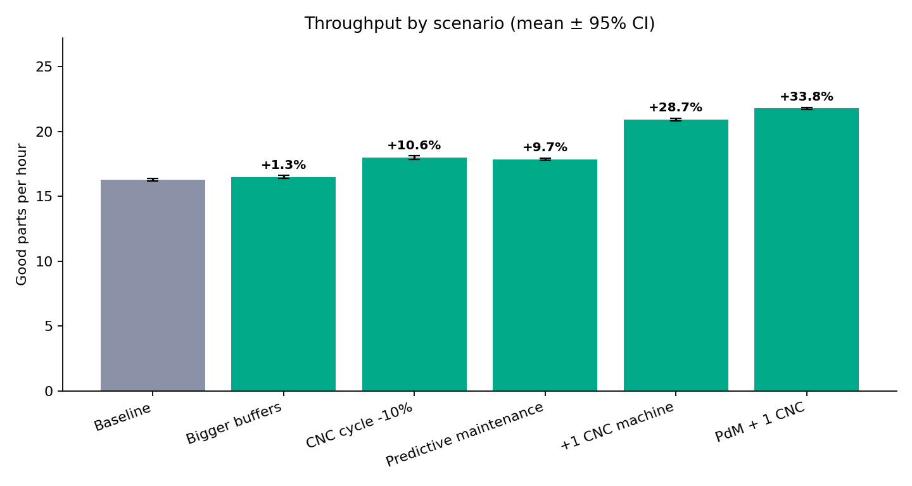
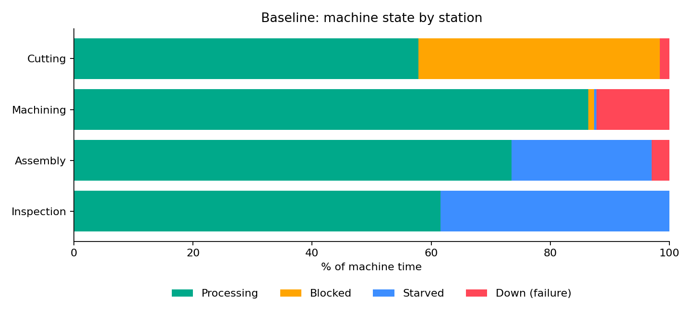

# 🏭 Production Line Simulation with SimPy

**Discrete-event simulation of a serial manufacturing line to find bottlenecks and compare improvement scenarios, including predictive maintenance.**

Academic project · Telkom University · Industrial Engineering (MEng)

## 🎯 Problem

A four-station production line (Cutting → CNC Machining → Assembly → Inspection)
suffers from random breakdowns, finite buffers and quality losses. Which
improvement gives the largest throughput gain: bigger buffers, faster machining,
predictive maintenance, or an extra machine at the bottleneck?

This simulation is a small **digital-twin-style what-if model**: change a
parameter, re-run, and compare KPIs before touching the real line.

## 🕹️ Interactive Simulator

An interactive Streamlit app lets you change every parameter (machines, cycle
times, MTBF/MTTR, buffers, scrap) or start from a preset scenario, and compares
your line with the baseline. It shows throughput, WIP, flow time, machine states
and **detects the bottleneck automatically**.

🔗 **Live demo:** [factory-line-simulator.streamlit.app](https://factory-line-simulator.streamlit.app)

To run it locally:

    streamlit run app.py

> Try it: start from *Baseline*, select the *+1 CNC machine* preset and watch the
> bottleneck move from Machining to Assembly.

## ⚙️ Model

| Element | How it is modeled |
|---------|-------------------|
| Processing time | Gamma distribution (given mean and CV) |
| Breakdowns | Exponential time between failures (MTBF) counted in *operating* time, exponential repair time (MTTR) |
| Buffers | Finite input buffers → machines become **blocked** (output full) or **starved** (input empty) |
| Quality | Scrap probability at each station |
| Supply | Unlimited raw material (line is always loaded) |
| Time unit | Minutes · 20 shifts × 8 h per run · first shift discarded as warm-up |

**Baseline line**

| Station | Machines | Mean time (min) | MTBF / MTTR (min) | Scrap |
|---------|---------:|----------------:|------------------:|------:|
| Cutting | 1 | 2.0 | 400 / 10 | 0.5% |
| Machining (CNC) | 2 | 6.0 | 180 / 25 | 2% |
| Assembly | 1 | 2.6 | 300 / 12 | 1% |
| Inspection | 1 | 2.2 | – | 3% |

> ⚠️ Parameters are **illustrative assumptions**, not measurements from a real factory.
> Replace them in `simulation.py` (`default_line`) with your own data.

## 📈 Results

30 replications per scenario (different random seeds), mean ± 95% confidence interval.

| Scenario | Throughput (parts/h) | Δ vs baseline | Avg WIP | Avg flow time (min) |
|----------|---------------------:|--------------:|--------:|--------------------:|
| Baseline | 16.27 ± 0.11 | – | 9.8 | 34.2 |
| Bigger buffers (5 → 15) | 16.48 ± 0.11 | +1.3% | 20.1 | 69.1 |
| CNC cycle time −10% | 17.99 ± 0.16 | +10.6% | 10.4 | 32.8 |
| Predictive maintenance | 17.84 ± 0.07 | +9.7% | 9.9 | 31.3 |
| +1 CNC machine | 20.93 ± 0.10 | +28.7% | 14.6 | 39.8 |
| Predictive maintenance + 1 CNC | 21.77 ± 0.08 | +33.8% | 15.4 | 40.2 |

**Key findings**

1. **Machining is the bottleneck.** It runs ~86% busy and ~13% down, while Cutting
   is blocked ~41% of the time and Assembly/Inspection are starved waiting for parts.
2. **Bigger buffers do not fix a bottleneck.** Throughput barely changes (+1.3%),
   but WIP and flow time roughly double.
3. **Predictive maintenance pays off** (about +10%) with almost no extra WIP,
   because it recovers capacity lost to downtime at the bottleneck.
4. **Adding capacity at the bottleneck is the strongest single lever** (+28.7%),
   and combining it with predictive maintenance gives the best result.

*Predictive maintenance scenario assumes condition monitoring avoids half of the
unplanned failures (MTBF × 2) and shortens repairs by 30% (MTTR × 0.7).*

## 🚀 Getting Started

    git clone https://github.com/Muat01/production-line-simulation-simpy.git
    cd production-line-simulation-simpy
    pip install -r requirements.txt

    streamlit run app.py          # interactive simulator
    python simulation.py          # one baseline run, prints KPIs
    python run_experiments.py     # all scenarios, saves tables and charts

Options: `python run_experiments.py --reps 50 --sim-time 19200`

## 📁 Project Structure

    ├── app.py                 # Interactive Streamlit simulator
    ├── simulation.py          # SimPy model (stations, breakdowns, buffers, KPIs)
    ├── run_experiments.py     # Scenarios, replications, confidence intervals, charts
    ├── .streamlit/config.toml # Theme
    ├── requirements.txt
    ├── results/               # CSV tables (scenario summary, station states)
    └── docs/                  # Generated charts

## 🔭 Possible Extensions

- Calibrate parameters with real production and downtime logs
- Connect to sensor data / health index from the
  [SUTM predictive maintenance dashboard](https://github.com/Muat01/sutm-predictive-maintenance-dashboard)
  to drive failure rates (digital twin)
- Add rework loops, shifts, operators and changeover times

## 👤 Author

**Muatasem Hadi** · MEng Candidate in Industrial Engineering, Telkom University ·
[LinkedIn](https://www.linkedin.com/in/muatasem-hadi)
